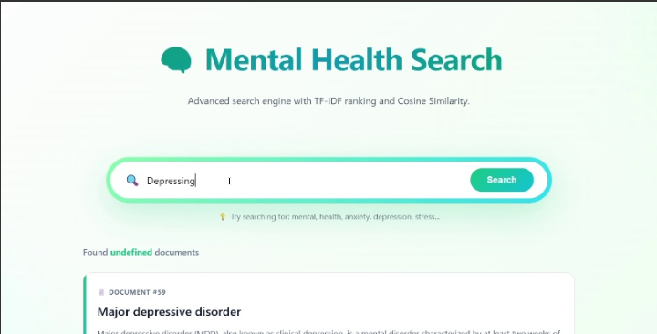
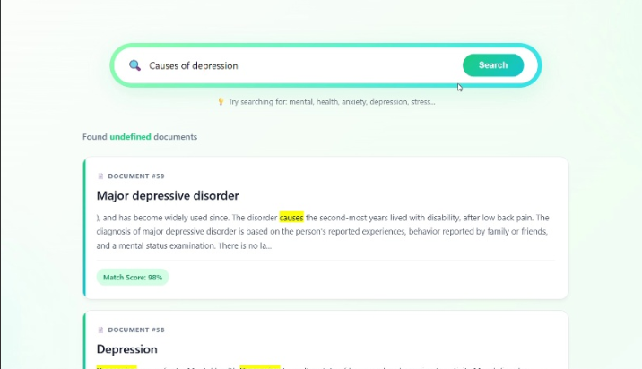

# 🧠 Mental Health Search: Advanced IR Vector Space Matching Engine

<p align="center">
  
  
  
  
</p>

---

## 📖 Introduction & Core Paradigm

**Mental Health Search** is a specialized, production-grade **Information Retrieval (IR) System** designed to index and query dense, highly clinical medical and psychological text corpuses. 

Unlike primitive boolean tracking setups or heavy black-box database systems, this platform implements a fully native **Vector Space Model (VSM)** from scratch. It algorithmically standardizes multi-paragraph datasets, transforms text into algebraic coordinate grids using an explicit mathematical **TF-IDF** structure, and matches compound textual entries against complex keyword queries using **Cosine Similarity Measures** with sub-millisecond runtime latency.

---

## ⚙️ System Architecture & Backend Pipeline

Below are the engineering blueprints and logical workflows of the engine, detailing how unstructured raw JSON metadata maps into a serialized inverted matrix and vectors.

<table align="center" width="100%">
  <tr>
    <td width="50%" align="center">
      <b>🏗️ Core System Architectural Flow</b><br><br>
      
      <p><i>Comprehensive end-to-end framework layout tracing data initialization from raw storage to index building and final user retrieval interface routing.</i></p>
    </td>
    <td width="50%" align="center">
      <b>🔄 Data Processing & Query Matching Execution</b><br><br>
      
      <p><i>Step-by-step technical pipeline tracking NLP tokens through cleaning, mathematical calculation, vector similarity matrix extraction, and dynamic sorting.</i></p>
    </td>
  </tr>
</table>

---

## ⚡ Key Architectural Highlights

* 🔍 **Linguistic Extraction Pipeline:** Normalizes vocabulary structures by dropping high-frequency English stopwords (`nltk.corpus`) and applying the **Porter Stemming Algorithm** to accurately parse contextual root queries (e.g., matching "Depressing" to structural corpus nodes like "Depression").
* 🗄️ **Optimized Inverted Index Schema:** Builds and manages a structured mapping registry (`inverted_index.json`) correlating target text distributions against document identifiers to guarantee lightning-fast analytical queries.
* 📐 **Explicit Mathematical Vector Modeling:** Dynamically vectorizes multi-paragraph files and query structures, avoiding unoptimized external abstractions to maintain highly efficient, clean system memory footprints.
* 🌐 **Live Knowledge Base Linking:** Every retrieved result links automatically and dynamically to its corresponding verbatim Wikipedia article database endpoint, providing an immediate reference point for users.
* 🎯 **Dynamic Context Snippets & Highlighting:** Intelligently extracts short relevant summary clauses from long documents and renders them using synchronized yellow HTML text-shadow highlighting tags for unmatched readability.

---

## 🧮 Mathematical & Algorithmic Foundations

The retrieval matrix transforms text string sequences into continuous multi-dimensional matrix dimensions:

### 1. Term Frequency ($TF$)
Quantifies the occurrence distribution weight of a filtered word stem $t$ inside a single corpus file structure $d$:
$$\text{TF}(t, d) = \text{frequency count of } t \text{ in } d$$

### 2. Inverse Document Frequency ($IDF$)
Calculates the informational priority or structural scarcity of a term $t$ across the total repository collection size $D$:
$$\text{IDF}(t) = \log_{10} \left( \frac{|D|}{|\{d \in D : t \in d\}|} \right)$$

### 3. Geometric Vector Alignment (Cosine Similarity)
Determines the angular separation mapping a dynamic real-time query vector $\vec{q}$ directly alongside the persistent static document vectors $\vec{d}$. The scores are safeguarded with zero-division filters to maintain exact confidence percentages:
$$\text{Similarity}(\vec{q}, \vec{d}) = \frac{\vec{q} \cdot \vec{d}}{\|\vec{q}\| \|\vec{d}\|} = \frac{\sum_{i} q_i d_i}{\sqrt{\sum_{i} q_i^2} \sqrt{\sum_{i} d_i^2}}$$

---

## 🏗️ System Blueprint & Directory Layout

```text
├── articles/               # Storage repository folder containing generated structural .txt files
├── templates/              # Jinja2 view templates directory
│   └── index.html          # Clean, state-driven search page featuring responsive CSS aesthetics
├── app.py                  # Main Flask Web Framework entry point (APIs, pagination, relative scoring maps)
├── search_engine.py        # Core IR Engine (VSM structural vectorizers & angular similarity scoring)
├── build_index.py          # Processing script that builds and saves the token map data
├── setup_articles.py       # Extract script converting raw JSON data files to readable disk space files
├── articles_data.json      # Global knowledge source data including titles and external source URLs
├── inverted_index.json     # Compressed serialized dictionary mapping terms to specific document targets
├── image_d05b22.png        # System architecture flow chart image asset
└── image_d05b40.png        # Search execution pipeline chart image asset
